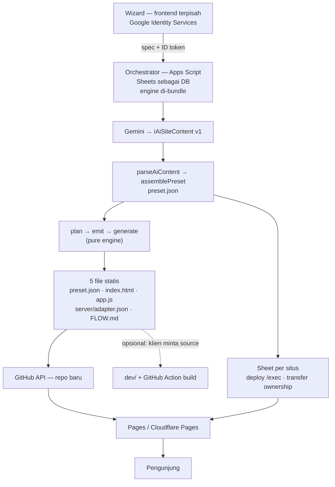

# Rajutan — system guide

> **Rajutan** is the orchestrator. It turns a business profile into a working website:
> it asks (wizard), writes (AI), assembles (preset), publishes (GitHub), and hands the
> data ownership to the client (Google Sheets). This document is the working guide for
> anyone — human or agent — picking the project up.

Last updated: 2026-11-11 · Framework version: `0.1.0` (fixed versioning)

---

## 1. What the system is

| Layer              | Name                              | Job                                                             |
| ------------------ | --------------------------------- | --------------------------------------------------------------- |
| Orchestrator       | **Rajutan**                       | wizard, AI calls, preset assembly, repo creation, deployment    |
| Frontend framework | **AIO UI** (`@aio-ui/*`)          | renders pages, owns styles, ships components                    |
| CMS / database     | **Google Sheets**                 | one spreadsheet per site; sheets are tables, columns are fields |
| API                | **Apps Script web app** (`/exec`) | serves rows, validates writes, caches                           |
| Distribution       | **GitHub**                        | site repositories + release artefacts (no npm registry)         |
| Hosting            | static CDN                        | serves the generated files; no server we operate                |

**Non-goals.** No runtime server we host; no login wall for visitors; no npm publish.
The AI never names a package, and generated sites never need a build step.

## 2. Principles

1. **Single source of truth.** A site's truth is `preset.json` + its spreadsheet. Code,
   CSS and assets are derived.
2. **Zero-cost.** Apps Script free tier, static hosting, CDN from a tag. Cached so the
   repeat cost is near zero.
3. **Build-free output.** Apps Script cannot run `tsc`/Vite, so "assembly" is selection
   and file writing. The browser loads ES modules through an import map.
4. **Closed vocabulary.** AI output is validated against a catalogue. An unknown builder
   or field type fails at the generator, never in a client's browser.
5. **Pinned engines.** Every preset records `engine.resolved`; a later release cannot
   break a live site.
6. **Reversible tooling.** Every build-time script is dry-run by default and only edits
   files git already tracks.

## 3. Infrastructure

| Piece                | Detail                                                     | Notes                                                      |
| -------------------- | ---------------------------------------------------------- | ---------------------------------------------------------- |
| Wizard               | frontend terpisah (tanpa user management)                  | Google Identity Services → spec + ID token ke orchestrator |
| Orchestrator         | Apps Script project (standalone)                           | Gemini key, service account GitHub, engine di-bundle       |
| Engine               | `.draft/preset/*` → bundle GAS                             | pure: tanpa `fs`/`path`/`fetch`; data in → file map out    |
| Template spreadsheet | one master file, duplicated per site                       | schemas managed by `TableBuilderService`                   |
| Gemini               | `gemini-2.5-flash`, `temperature 0.2`, JSON output         | prompt: `.draft/preset/prompt.content.md`                  |
| Drive                | temporary custody of the duplicate                         | ownership transferred to the client, then detached         |
| GitHub               | one repo per site from a template; releases hold artefacts | framework releases: `sieteminerva/-aio-ui-dev`               |
| Hosting              | GitHub Pages atau Cloudflare Pages (belum diputuskan)      | build-free: lima file statis per situs                     |
| Actions (opsional)   | build dari `dev/` untuk klien yang meminta source          | bukan jalur kritis; tidak dipakai oleh generator           |
| CDN                  | jsDelivr `gh` paths or the release folder                  | assets immutable per tag                                   |
| Client CMS           | the client's own spreadsheet `/exec`                       | data reads come from here, not from us                     |

## 4. Framework map

```
packages/
  base/  core/  app/  utilities/  styles/
  components/  accordion article badge carousel fabmenu footer form id-address
               input masonry menu message modal modeswitcher pricingcard
               product rating section tab table
  modules/     animations event-emitter http-service module-loader router theme
  themes/      cyberpunk default horizontal
```

Conventions that must not drift:

- **Definitions + manifest.** Capabilities are declared as `*_DEFINITIONS` (live objects)
  and referenced as `*_MANIFEST` (paths + ids). `scope` states intent; ids decide.
- **One stylesheet per owner** (`Form.css`, `input.css`, `Message.css`, …) injected
  through `@aio-ui/core/Stylesheets`. A component never imports its own CSS.
- **Tokens at `:root`**, themes put `--app-*` on `body[data-theme]`.
- **Boundaries are mechanical**: `npm run check:bounds` fails on an undeclared edge.
- **Messages are data**: `iFormConfig.messages` (`category` → `slot` → `code`).

## 5. Contracts

### 5.1 AI output — `iAiSiteContent` v1 (`.draft/preset/ai.ts`)

```json
{
  "contentSchema": 1,
  "site": { "tagline": "…", "seo": { "title": "…", "description": "…" } },
  "pages": [{ "id": "home", "route": "/", "content": { "…": "…" } }],
  "notes": ["asumsi model"]
}
```

The model writes **content only**. Orchestrator facts (`id`, `engine`, `model`, `theme`,
`data`) are merged by `assemblePreset()`; a model that echoes a different theme is ignored.

### 5.2 Site document — `iWebPreset` v1

```json
{
  "id": "tenun-lestari",
  "presetSchema": 1,
  "engine": { "range": "^0.1.0", "resolved": "0.1.0" },
  "model": "store",
  "theme": "cyberpunk",
  "site": { "name": "Tenun Lestari", "locale": "id" },
  "pages": [{ "id": "catalog", "route": "/produk", "content": { "…": "…" } }],
  "data": [{ "id": "products", "sheet": "products", "endpoint": "https://…/exec" }],
  "wizard": { "answers": { "…": "…" }, "generatedAt": "2026-11-10T00:00:00.000Z" }
}
```

### 5.3 Derivation — `plan(preset)`

Content → capability table (`.draft/preset/catalogue.ts`):

| Signal                                                    | Adds                                                                                             |
| --------------------------------------------------------- | ------------------------------------------------------------------------------------------------ |
| _(always)_                                                | `base`, `core` (registry/renderer/stylesheets), `app`, `router`, `theme` + `theme-*`, global CSS |
| `data[]` present                                          | `http-service`                                                                                   |
| `animation=` attribute                                    | `animations`                                                                                     |
| builder word                                              | that component + its stylesheet                                                                  |
| `builder: "form"`                                         | `form`, `input`, `validation`, `Input.FormAdapter`, `message` + its adapter                      |
| field type `dropdown`/`file`, `config.popover`, `actions` | input module `dropdown`/`file-uploader`/`popover`/`controls`                                     |
| `config.address`                                          | `id-address` (+`idAddress` module id)                                                            |
| group with `table`                                        | `table` + `table/adapters/FormAdapter`                                                           |
| `multistep` / `cascading` / `calculation`                 | the matching form adapter                                                                        |

`plan()` returns `capabilities`, `baseStyles`, `modules`, `components`, `bindings`
(`word → specifier`), `moduleRefs` (`id → specifier + named export`) and `assets`.

### 5.4 Runtime — `emit` + `runtime`

`emitPlan()` turns the plan into `{ links, importMap, table, bindings, moduleRefs }`.
The import map **must include package prefixes** (`"@aio-ui/utilities/"`), otherwise a
component's own imports do not resolve. `runtime.ts` then writes `index.html` + `app.js`.

### 5.5 Server side — response envelope

```
GET  <endpoint>?sheet=<name>&page&limit&sortBy&order&lang[
  &apiKey]  → { statusCode, success, message, data, meta }
POST <endpoint>  { action: "create" | "update" | "delete", sheetName, data }
```

Address picker contract (unchanged from the legacy API):
`?level=propinsi`, `?level=kota&parentId=…`, … `?level=detail&kodepos=…&location=true`.
The rewritten backend lives in `.archives/idAddress-AppsScript/` (metadata-driven columns,
OAuth instead of public sheets, query cache).

## 6. Mechanism (end to end)



Generated-site flow:

- **Static model** (no `data[]`): `index.html` + `app.js` are the whole website.
- **Dynamic model** (`data[]`): same files plus `server/adapter.json`; `HttpService`
  points at the client's `/exec`.
- **Source on request**: `dev/` is generated for every site but handed over only when the
  client asks; an optional GitHub Action can build it. The critical path never needs a build.
- **Cache layers** (mirrors `docs/GoogleSheets CMS/Technical-Detail - Caching.jpg`):
  browser `localStorage` → Apps Script `CacheService` (6 h) → immutable CDN per tag.

## 7. Outputs

### 7.1 Per generated site (`.draft/results/<scenario>/`)

```
preset.json          the document (regenerate from this)
index.html           import map + stylesheet links
app.js               registrations + bootstrap
server/adapter.json  static flag, sources[], cache plan, capabilities
FLOW.md              operator map
dev/                 Vite copy: index.html, vite.config.ts, src/main.ts
```

### 7.2 Per release (`.draft/release/v<version>/`)

```
aio-ui-<name>-<version>.tgz   × 37
registry.json                version, base URL, per-package subpaths + tarball + integrity
layout.json                  dir / entry / stylesRoot / bare per package
checksums.txt                sha256 per tarball
```

Uploading that folder as a GitHub Release asset turns it into the install source:
`npm i <tarball URL>` for bundler users, `registry.json` for the generator's import map.

## 8. Commands

```bash
npm run verify                     # build:pkgs → typecheck → bounds → version:check → tests → build
npm run version:report             # versions + peer ranges
npm run version:check              # exit 1 on drift or non-semver peers
node scripts/version.mjs --apply --version 0.1.1
node scripts/release.mjs --version 0.1.1             # dry run
node scripts/release.mjs --version 0.1.1 --apply     # artefacts in .draft/release
node .draft/preset/layout.mjs --out .draft/preset/layout.json
npx vitest run .draft/preset       # generator suite (98 tests)
npx tsc -p .draft/preset/tsconfig.json
cd .draft/results/gallery-static_v1/dev && npx vite --port 5199
```

## 9. Status (honest)

**Working**

- **Monorepo migration is complete** (the nine-phase plan that produced this layout).
  Its `monorepo_plan.md` / `monorepo_task.md` were removed because every phase landed;
  the generator idea from that plan is now this document's preset engine, not an
  Inquirer CLI.
- 37 packages build (`dist` + `.d.ts` + CSS), `dist` exported conditionally.
- Form family: module registry, messages config, animations contract, address adapters.
- Generator: parse → assemble → plan → emit → runtime → **physical files**, with 98 tests.
- Semver fixed at `0.1.0`; peers rewritten; version check wired into `verify`.
- Release artefacts regenerated: **37 tarballs** + `registry.json` + `layout.json` + `checksums.txt`
  (37/37 checksums verified; the three kits are included).
- Build-free proven from the **release layout**, not just `dev/`: both generated sites load
  `@aio-ui/*` through the import map with a clean console (form = 1 fieldset + 3 fields;
  gallery masonry = 4 children, carousel = 1).
- Build-free is the primary delivery: five static files per site, framework served from the
  pinned CDN tag; `dev/` stays as the opt-in source hand-over.

**Known gaps**

1. **The tag is not published yet** — the generated import map points at
   `cdn.jsdelivr.net/gh/…@v0.1.0`; the local smoke test rewrites the base to the release folder.
2. **Node ESM clean install** is untested. Emitted JS now names `.js` explicitly and drops CSS
   side-effect imports, so the old extensionless limitation is gone; a clean `npm i` is still
   the proof.
3. **`npm i <tarball>` from a clean folder** not yet proven in this environment; verify
   with a bundler project when the first tag exists.
4. **`layout.json` freshness** is manual until the release workflow regenerates it; the current
   folder is fresh at 37 packages.

## 10. Roadmap

| Stage               | Deliverable                                                                                 | Gate                           |
| ------------------- | ------------------------------------------------------------------------------------------- | ------------------------------ |
| A. Contract freeze  | preset + AI + derivation tables                                                             | ✅ done                        |
| B. Preset engine    | plan / parse / ai / emit / runtime / generate                                               | ✅ done (draft)                |
| C. Generator wiring | orchestrator returns `data.preset`; wizard renders `preset.pages`                           | demo renders a preset page     |
| D. Delivery         | semver ✅, release artefacts ✅ (37, verified), **release workflow**, CDN import-map target | one tag installable two ways   |
| E. Hardening        | docs sync, builder mount fix, IdAddress payload naming, multistep messages                  | `verify` green                 |
| F. Optional         | per-feature packages if a consumer needs one behaviour alone                                | install without `@aio-ui/form` |

Next three tasks, in order:

1. Push tag `v0.1.0` (pre-release) and upload `.draft/release/v0.1.0` as its assets.
2. Re-run the build-free smoke test from the real CDN tag (the local run is already green).
3. Build the missing manual model references (profile, store, blog) — the official release gate.

> **Release policy.** Test tags are allowed after `npm run verify` and may be regenerated.
> An **official** release happens only when all four models (§3.5) exist as manual, browser-
> verified references with their boundaries documented — so the contract is proven before it is
> promised.

## 11. How to work on this (for agents)

1. **Read before writing**: `.guidance/plan.md` (open work), `.guidance/AGENT_RULES.md`
   (hard rules), this guide, and the module you touch.
2. **Drafts first**: new engine code lives in `.draft/<topic>/` until its shape is stable;
   only then move it to `scripts/` or a package.
3. **A capability belongs in a module; a component only renders.** Never import a
   component's CSS from JS, never couple `packages/*` to the CMS.
4. **Test the derivation, not the wording.** One test per catalogue row; a prompt test
   keeps the AI vocabulary equal to `Object.keys(BUILDER_CATALOGUE)`.
5. **Physical output beats string assertions** for anything a browser consumes.
6. **Keep it reversible**: dry-run defaults, `--apply` to write, and say in the report how
   to undo.
7. **Report honestly**: what passed, what was measured, what is still broken.

### Restore / rollback

```bash
git restore packages package.json package-lock.json   # undo version bumps
rm -rf .draft/release                                  # undo release artefacts
rm -rf .draft/results                                  # undo generated sites
git status --short                                     # confirm nothing unintended
```

Stop any `vite` process before regenerating `.draft/results` (Windows locks the folder).

## 12. Reference documents

| Doc                                                    | Content                                                     |
| ------------------------------------------------------ | ----------------------------------------------------------- |
| `.guidance/plan.md`                                    | open work, decisions, stages                                |
| `.guidance/AGENT_RULES.md`                             | hard working rules                                          |
| `.guidance/mandatory/`                                 | non-negotiable working rules                                |
| `.guidance/rules.md`, `.guidance/project/`             | repository conventions                                      |
| `docs/presentation0.md`                                | product vision and business framing                         |
| `docs/apps-script-integration.md`                      | orchestrator flow: auth → Gemini → Sheets → deploy → detach |
| `docs/GoogleSheets CMS/REST_API.MD`                    | server contract (`/exec`)                                   |
| `docs/GoogleSheets CMS/Technical-Detail - Caching.jpg` | cache layers                                                |
| `.archives/wizard.ts`                                  | reference wizard (the `store` model flow)                   |
| `.draft/preset/README.md`                              | generator internals and rules                               |
| `.draft/preset/prompt.content.md`                      | the AI prompt                                               |
