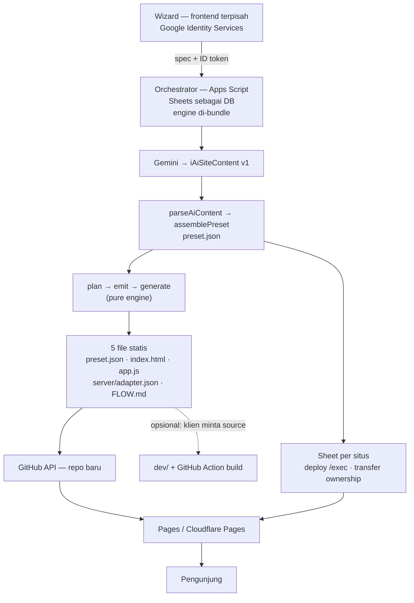

# AIO UI Framework — plan

Long-term **why** for three projects in one repo: `@aio-ui/*` (framework, §1), `examples/gallery`
(profile model, §2) and Rajutan (generator, §3). Shared parts come first (§0). Only open work
lives here; what landed is `git log` (one commit per decision, each naming its evidence) and the
architecture docs under `docs/`. The system guide is `.guidance/RAJUTAN.md`.

Last updated: 2026-11-11

Tracking pipeline: this file = **why / long-term**. Next actions live in
`.guidance/project/NEXT_TASKS.md` (queue); the 3 items being worked live in
`.guidance/project/STATUS.md`. One item lives in exactly one file (`AGENT_RULES.md` §9).

---

## 0. Shared — all three projects

### 0.1 Objective

Two layers, one source of truth:

1. **`@aio-ui/*`** — a monorepo framework whose components are independently installable,
   rendered by one registry, styled by lazily-loaded stylesheets, and built as real packages
   (`dist` JS + `.d.ts`). The form family is the reference implementation: it owns its
   engines, composes sub-modules through a manifest, and runs without the app.
2. **Webapp generator** — a wizard (`docs/presentation0.md`) that turns a business profile
   into an AI-generated site definition, then emits **a preset**: the exact subset of
   components, modules, styles and data sources that one generated website needs. The user
   keeps editing content in Google Sheets; the generator never keeps access.

The preset is the contract between AI output, the Sheets CMS, and this framework.

### 0.2 Constraints

- **TypeScript ~6.0** with `verbatimModuleSyntax`, `erasableSyntaxOnly`, `noUnusedLocals/Parameters`.
- **Vite 8 / rolldown** for the examples; `lightningcss` for sheets.
- **npm workspaces**: `packages/*`, `packages/components/*`, `packages/modules/*`,
  `packages/themes/*`, `examples/*`.
- **Boundaries are mechanical** (`scripts/bounds.mjs`): package edges follow the dependency
  graph, every deep import resolves through the target's `exports` map.
- **A capability lives in a module; a component only renders.** No builder imports its own CSS.
- **Zero-cost infrastructure**: Apps Script (CMS + orchestrator), static hosting (Pages/CDN),
  no server we operate.

### 0.3 Decisions already made

| Area           | Decision                                                                                                                                                                                                                                                                                |
| -------------- | --------------------------------------------------------------------------------------------------------------------------------------------------------------------------------------------------------------------------------------------------------------------------------------- |
| Package layout | One package per component; sub-modules are subpaths of their owner, not packages — every `exports` subpath names one file.                                                                                                                                                              |
| Module sets    | `*_DEFINITIONS` (live definitions) + `*_MANIFEST` (refs, `scope: "form" \| "input"`); a nesting component partitions by id.                                                                                                                                                             |
| Styling        | One sheet per owner, injected once through `@aio-ui/core/Stylesheets`; field styling lives in `@aio-ui/input/input.css`, form chrome in `Form.css`.                                                                                                                                     |
| Tokens         | Declared once at `:root` (+ `[data-theme]`, where themes put `--app-*`), never per `.field`.                                                                                                                                                                                            |
| IdAddress      | Adapter-based: `native`, `aio`, `base`, opt-in via `config.address.useAdapter`. The Apps Script backend was rewritten (`.archives/idAddress-AppsScript/`): metadata-driven columns, OAuth instead of public sheets, query cache, same HTTP contract.                                    |
| Animations     | One uniform contract: `AnimationBehaviour<Options>` with `animate({ node, options, delay, signal, stopped, done })`, resolved through a registry, not a `switch`. Cancellation is an `AbortController` per run.                                                                         |
| Form messages  | Every user-facing sentence resolves through `iFormConfig.messages` (`category` → `slot` → `code`), with template strings for JSON/CMS config and functions for dynamic cases. Defaults preserve the previous wording exactly. Calculation failures report once per changed failure set. |
| Data contract  | Server responses are always `{ statusCode, success, message, data, meta? }` (`docs/GoogleSheets CMS/REST_API.MD`). The wizard's build result is `{ status, meta, data: { sheet, repo, live, guide, message } }`.                                                                        |
| Publish        | `tsc` per package to `dist`, `exports` conditional: `development` → source, `types`/`default` → `dist`. Built in dependency order by `scripts/build-pack.mjs`.                                                                                                                          |

## 1. Project: framework — `@aio-ui/*` (`packages/*`, `examples/demo`)

The framework ships independently installable packages. Its open work is cleanliness, the
publishing/install path, and the limits accepted on purpose.

### 1.1 Remaining work

#### 1.1.1 Docs and cleanliness

- `docs/FIELD-TYPES.md` is out of sync with `packages/components/input/FieldTypes.ts`.
- Dead `console.log`, commented-out blocks and mojibake left in adapters.
- `Form.css` audit (chrome-only now; verify nothing field-level survived).
- `docs/GoogleSheets CMS/ARCHITECTURE.MD` is empty (0 lines) — fill or delete.

#### 1.1.2 Decided but not implemented

- **IdAddress payload names.** `beforeSubmit` maps `<level>_name` → `<level>`, while the demo
  names controls `address-<level>`: ids land in the payload, resolved names do not. Pick one
  convention, then the adapter follows it.
- **Multistep notices.** `messages.multistep.*` exists in config but nothing emits it; decide
  whether step navigation should speak or stay silent (validation already covers it).

### 1.2 Publishing and on-demand install (no npm)

Decided direction: **GitHub as the only origin**, two doors from one build.

- 1.2.1 **Semver for real.** ✅ Fixed versioning at `0.1.0` via `scripts/version.mjs`;
  `version:check` runs inside `verify`. Undo with `git restore packages package.json`.
- 1.2.2 **Release pipeline.** ✅ local half: `scripts/release.mjs` writes 37 tarballs +
  `registry.json` + `layout.json` + `checksums.txt` into `.draft/release/v<ver>/`
  (dry-run by default), verified by `.draft/preset/release.test.ts`. ✅ **Published:** tag
  `v0.1.0` on `sieteminerva/-aio-ui-dev` points at the orphan `cdn` branch built by
  `scripts/publish-cdn.mjs` (it unpacks the tarballs so jsDelivr serves the import map); 40
  release assets uploaded. ⏳ GitHub Actions on tag still to write.
- 1.2.3 **Import-map build target.** ✅ Delivered 2026-11-11: emitted JS names `.js`, drops CSS
  side-effect imports, the layout carries real `exports` subpaths (CSS prefers `dist/`), and the
  tag resolves on jsDelivr. Real-CDN smoke is green for both generated sites.
- 1.2.4 **Host asset maps generated, not hand-written.** One entry per manifest `path` today;
  `ComponentRegistry.loadModule` only warns when missing, so a typo silently falls back to the
  built-in preset. Derive loaders from `import.meta.glob` or generate a virtual module.
  `scope` must never be derived — it is a component decision.
- 1.2.5 **Scope vs repo owner.** `github.com/sieteminerva/-aio-ui-dev` ≠ `@aio-ui/*`. Irrelevant for
  tarball/CDN installs; only GitHub Packages would require renaming the scope. Keep the scope.
  `scripts/release.mjs` defaults to that repository; `GITHUB_REPOSITORY` overrides it for a fork.
- 1.2.6 **Pin what a site was built with.** Every preset carries
  `engine: { range: "^0.1.0", resolved: "0.1.3" }`. The generator resolves the range once and
  stores both: `resolved` is what the runtime loads (exact URLs, so a later release never
  breaks a live site), `range` documents the intent for a deliberate regeneration. In 0.x a
  minor bump is treated as breaking.

### 1.3 Known limits, deliberately deferred

- **Node ESM.** `tsc` does not rewrite relative imports, so emitted JS is extensionless
  (`import "./FormLayout"`): consumers must be bundlers. Full support means
  `moduleResolution: node16` plus `.js` extensions in every source import.
- **Apps Script cold start** (2–5 s on the first idle call) cannot be removed from the script;
  only the repeat cost is cached. The generator's first paint must not depend on it.
- **Fase 7-22 (optional).** `cascade`/`multistep`/`validation`/`calculation` could become
  installable packages instead of subpaths of `@aio-ui/form`.

### 1.4 Order here

1. **Test tag** ✅ (1.2.2) — `v0.1.0` published (tag on the `cdn` branch) dan CDN import map
   terbukti di browser. Berikutnya: otomatiskan langkah yang sama di GitHub Actions.
   **Official release** menunggu empat referensi model manual (§3.5, §3.10).
2. **Model references** — `store`, `profile`, `blog` (§3.5); the official-release gate.
3. **Docs batch** (1.1.1) — field types, dead code, `Form.css`, empty `ARCHITECTURE.MD`.

## 2. Project: gallery — `examples/gallery` (profile model)

Long-term: gallery is the reference `gallery` model (§3.5) and the first site the generator must
be able to reproduce — a personal archive (software, visual/motion, fabrication, music), not a
generic portfolio template. The content principle lives in `.guidance/project/README.md`.

Open design decisions:

- **Portfolio data schema** — the record shape (category, problem/process/result, media) must be
  decided before record pages are built.
- **Content model** — blog plus EN/ID pairs must exist before a language switcher means anything.

Queue: `NEXT_TASKS.md` → Gallery lane. No other project is blocked on gallery.

## 3. Project: generator — Rajutan (`.draft/preset/`, orchestrator)

Build-time logic that turns a business profile into a preset and a site repository. Server-side,
never a package (§3.10). Stage B already landed in draft (§3.7).

### 3.1 Big picture: from wizard to preset to site



Build-free adalah jalur utama: repo klien hanya berisi lima file di atas, dan seluruh
`@aio-ui/*` dimuat dari CDN pada tag `engine.resolved`. `dev/` (proyek Vite) tetap
digenerate tetapi hanya diserahkan bila klien memintanya. GitHub Actions bukan bagian dari
jalur kritis — ia hanya opsi untuk permintaan source/build (§3.10).

### 3.2 Input object contract (Apps Script ↔ `@aio-ui`)

The two sides already speak the same shapes; the preset must reuse them, not invent a third.

| Direction       | Shape                                                                                                                  |
| --------------- | ---------------------------------------------------------------------------------------------------------------------- |
| Content AST     | `iBasicNode[]` / `iNodeContent` with token keys: `#id`, `.class`, `tag`, `>child` (`docs/DOMRenderer.md`)              |
| Builder payload | `{ builder, content }` or `{ builder: "form", config, schema }`; the wizard sends exactly this                         |
| Server → client | `{ statusCode, success, message, data, meta? }`; `data` is the payload, `meta` carries pagination links                |
| Build result    | `{ status: "success" \| "partial" \| "error", meta, data: { sheet, repo, live, guide, message } }`                     |
| Sheet rows      | Column titles are the field ids (`snake_case`); `GET /exec?sheet=…&page&limit&sortBy&order&category&lang`              |
| Address levels  | `?level=propinsi\|kota\|kecamatan\|kelurahan\|kodepos&parentId`, `?level=detail&kodepos`, `?level=geocode` — unchanged |

### 3.3 What a preset is

Data, not code. One JSON document per generated site:

```ts
interface iWebPreset {
  id: string; // slug
  presetSchema: 1; // document shape; bumped only when the parser changes
  /** Framework release this site was generated against (§1.2.6). */
  engine: { range: string; resolved: string };
  model: "gallery" | "profile" | "store" | "blog"; // §3.5
  theme: string; // "default" | "cyberpunk" | …
  site: { name: string; locale: string; domain?: string };
  pages: Array<{ id: string; route: string; content: iNodeContent }>;
  /** Capabilities the pages actually use — derived, never hand-listed. */
  modules: Array<{ id: string; path: string; scope?: string }>;
  components: string[]; // "@aio-ui/article", "@aio-ui/product", …
  /** One entry per package: JS specifier + stylesheet specifiers. */
  assets: Array<{ specifier: string; styles: string[] }>;
  data: Array<{ id: string; sheet: string; endpoint: string; params?: Record<string, unknown> }>;
  wizard: { answers: Record<string, unknown>; generatedAt: string };
}
```

Derivation rules live in code and are tested; the AI only writes `site`, `pages`, `theme`, and
`data` intents. `modules`, `components` and `assets` are **computed** from `pages` — same
reasoning as `*_MANIFEST`: a manifest states intent, ids decide.

### 3.4 Capability map (the table stage A has to freeze)

Every row is a signal found in `pages`, and what it drags in. Nothing is hand-listed by the AI.

| Signal in the preset                                                                                                                                                                         | Added                                                                     |
| -------------------------------------------------------------------------------------------------------------------------------------------------------------------------------------------- | ------------------------------------------------------------------------- |
| _(always)_                                                                                                                                                                                   | `base`, `core` (stylesheets), `utilities`, `theme`, one `theme-*` package |
| more than one page / non-hash routing                                                                                                                                                        | `router`                                                                  |
| any `data[]` entry                                                                                                                                                                           | `http-service`                                                            |
| any `animation="…"` attribute                                                                                                                                                                | `animations`                                                              |
| page/component events are enabled                                                                                                                                                            | `event-emitter`                                                           |
| builder word in content (`section`, `article`, `product`, `pricingcard`, `carousel`, `masonry`, `accordion`, `tab`, `menu`, `fabmenu`, `footer`, `badge`, `rating`, `modal`, `modeswitcher`) | that component + its stylesheet                                           |
| `builder: "form"`                                                                                                                                                                            | `form` + `input` + `validation` adapter (+ `Form.css`, `input.css`)       |
| form field `type: "dropdown"` / `"file"` / `config.popover` / `actions`                                                                                                                      | input module `dropdown` / `file-uploader` / `popover` / `controls`        |
| `config.address` on a form                                                                                                                                                                   | `id-address` + `id-address/adapter.aio`                                   |
| a group carrying `table`                                                                                                                                                                     | `table` + `table/adapters/FormAdapter`                                    |
| submit feedback expected                                                                                                                                                                     | `message` + `message/adapters/FormAdapter`                                |
| `multistep: true` / `cascading: true` / `calculation: true`                                                                                                                                  | the matching `form` adapter module                                        |

Two rules make the map usable: a signal only ever **adds**, never removes (validation of
"is this complete" is a separate pass), and each row must be expressible as data, so the same
table can drive the runtime asset map and the release manifest.

### 3.5 Webapp models

A model is a preset template: the page skeleton, the wizard questions, and the AI prompt that
together produce a preset. Ship few and finish them.

| Model     | Pages                                  | Extra capabilities                         |
| --------- | -------------------------------------- | ------------------------------------------ |
| `gallery` | home, item list, item detail, about    | masonry, carousel, modal, animations       |
| `profile` | home, services, contact, portfolio     | section, article, fabmenu, message         |
| `store`   | home, catalog, product, cart, checkout | product, pricingcard, form, table, message |
| `blog`    | home, post list, post, about           | article, menu, pagination                  |

The wizard in `.archives/wizard.ts` is the `store` flow; `examples/gallery` is the `gallery`
model, not the generator itself.

**Reference status (2026-11-11):** `examples/gallery` exists for the `gallery` model; `profile`,
`store` and `blog` have **no manual reference yet**. The official release gate (§3.10) waits for
all three, because each model is where the catalogue's real boundaries become visible.

### 3.6 Remaining work — preset engine

`packages/*` keeps shipping only `@aio-ui` packages. The engine lives in `.draft/preset/` until
its shape settles, then moves into the separate Apps Script orchestrator as a bundled script
(§3.10) — never into a package.

- 3.6.1 **Preset schema + validator** (`iWebPreset` v1): `parse()` refuses unknown component
  ids and unknown builder words, so an AI hallucination fails at the generator, never in a
  client's browser.
- 3.6.2 **`plan(preset)` derivation**: implements §3.4 as a data table (signal → adds), with
  one test per row. No `if` chains.
- 3.6.3 **`assetsOf(preset)`** — emits the asset map the host currently writes by hand in
  `examples/*/src/registry.assets.ts`; also emits the `<link>` list and the import map.
- 3.6.4 **Assembly via GitHub API** (server side): create the site repo from a template
  (`POST /repos/{template}/generate`), commit `preset.json` + `index.html` + `app.js` +
  `styles.css` through the Contents API, then enable Pages. Apps Script cannot run
  `tsc`/Vite, so "assembly" is **selection + file writing**, never compilation.
- 3.6.5 **Build-free runtime template** (§3.8.5): `index.html` with an import map + `app.js` that
  fetches `preset.json`, registers only the listed components, then renders `preset.pages`.
  A preset without a build step is the only shape that works on zero-cost static hosting.
- 3.6.6 **Wizard hand-off**: the orchestrator returns `data.preset` alongside
  `sheet/repo/live/guide`; the wizard renders `preset.pages` instead of a hardcoded page list.

### 3.7 Execution stages

Each stage ends at a gate: `npm run verify` plus the named evidence.

| Stage                   | Deliverable                                                                                                           | Evidence                                                              |
| ----------------------- | --------------------------------------------------------------------------------------------------------------------- | --------------------------------------------------------------------- |
| **A. Contract freeze**  | `iWebPreset` types + capability table (content → modules/components/assets) + AI output contract                      | Reviewed table; no code yet                                           |
| **B. Preset engine**    | `plan(preset)`, `assetsOf(preset)`, `parsePreset()`/`parseAiContent()`, `emitPlan()`; tests for every derivation rule | Unit tests: a form page pulls form+input, a static page pulls neither |
| **C. Generator wiring** | Orchestrator returns `data.preset`; wizard renders `preset.pages`; `registry.assets.ts` replaced by generated map     | Demo renders a preset-shaped page; asset map equality test            |
| **D. Delivery**         | Semver bump, release workflow, import-map target, `registry.json`                                                     | One real tag installable both as tarball and via import map           |
| **E. Hardening**        | Docs sync, dead code, IdAddress naming, multistep messages                                                            | `verify` green; docs match code                                       |
| **F. Optional**         | Per-feature packages if a consumer needs one behaviour alone                                                          | A package installed without `@aio-ui/form`                            |

Order matters: A → B is what makes C cheap; D can run in parallel with B once A is frozen.

**Where we are (2026-11-11): stage B complete in draft; stage C unblocked, orchestrator wiring next.**
`.draft/preset/` now holds: `types.ts` (`iWebPreset` v1), `catalogue.ts` (the capability
table), `plan.ts` (`plan`/`assetsOf` → modules, bindings, moduleRefs, assets), `parse.ts`
(`parsePreset`/`assertPreset`, shape + closed vocabulary), `ai.ts` (AI output contract
`iAiSiteContent` v1 + `parseAiContent`/`assemblePreset`/`aiResponseSchema`), `emit.ts`
(`{ links, importMap, table, bindings, moduleRefs }` + `createCdnResolver` + prefix map), `runtime.ts`
(`index.html` + `app.js`, build-free), `layout.mjs` → `layout.json` (37 packages) and
`prompt.content.md` (whose builder list a test keeps in lockstep with the catalogue).
100 draft tests (99 run + 1 opt-in CDN smoke); whole suite 428/46 (+1 skipped). `.draft/results/` now holds two generated sites
(`gallery-static_v1`, `store-dynamic_v1`), each with `preset.json`, `index.html`, `app.js`,
`server/adapter.json` and `FLOW.md`. The `dev/` copies run in a browser; on 2026-11-11 the
emitted runtime gained a mount pass (`onCreated` → `build`) and module refs now carry their
export name, so `#checkout-form` renders fieldset + fields and the gallery mounts masonry +
carousel, both with a clean console. Build-free files still wait on a real tag (stage D). The
framework side is ready; the generator side is still a mock (`mockBuildResult()` in
`.archives/wizard.ts`).

### 3.8 Decisions from the 2026-11-10 review

1. **Preset engine is server-side.** Not a `@aio-ui` package: `packages/*` only ships framework
   packages. It lives with the generator (`scripts/preset/` here or a sibling orchestrator
   project) and may be _imported_ by a package only if a runtime ever needs the validator.
2. **Derivation is code, assembly is server logic.** The AI writes `pages`/`theme`/`data`
   intents; the server derives modules/components/assets (§3.4) and calls the GitHub API to
   create the site repo. The AI never names a package.
3. **Versioning: schema version + resolved engine version.** `presetSchema: 1` for the document
   shape; `engine.resolved` for the exact framework release the site was generated against
   (§1.2.6). Regeneration is explicit, never automatic.
4. **The app shell is generated from the preset, not a fixed template.** The _shape_ is a
   template (build-free `index.html` + `app.js` + `styles.css` + `preset.json`), but its
   contents — pages, component registrations, import map, stylesheet links — come from the
   preset. Gallery/profile/store/blog (§3.5) differ only by preset, not by code.
5. **Build-free is a hard constraint.** Apps Script cannot run `tsc`/Vite, so the generated
   site must work without a build step. A Vite template can remain as an _option_ for users
   who later want to edit locally, never as a requirement.

#### Still open

- **Do we accept a first paint that fetches `preset.json`?** Build-free can still inline the
  preset into `app.js` at generation time (no fetch, one more API call on GitHub). Inline is
  faster and works offline; a separate file is easier to regenerate. Proposal: inline by
  default, keep `preset.json` beside it as the source of truth.
- **Wizard placement.** `.archives/wizard.ts` (store flow) is the reference; the generator's
  own wizard UI still needs a home (separate repo or `examples/generator`).

### 3.9 Order here

1. **Final content schema (Sheets ↔ `@aio-ui`)** — one table per model (products, posts, orders):
   column → field type, validation rules, message limits. Gate: one full store cycle — real sheet
   → `/exec` → `HttpService` → component renders rows.
2. **Build-free smoke test** — serve a generated site from a real tagged release; closes the
   "build-free" claim that is only proven structurally today.

Order rationale: 1 next because it is the largest remaining design job; 2 last because release
work (stage D) is what makes it possible. The former item 1 (mount builders) landed on
2026-11-11.

### 3.10 Decisions from the 2026-11-11 review

1. **Orchestrator is a separate Apps Script project.** Same platform as the CMS, so its own
   Sheets are the job/identity DB. The engine (`plan/emit/runtime/generate/parse/ai`) is bundled
   into it with the existing GAS compiler. The engine must stay **pure**: no `node:fs`, `path`,
   `process`, no `fetch` — it receives data and returns a file map. `layout.json`/`registry.json`
   are produced at release time and shipped as data, never scanned at runtime.
2. **Wizard is a separate frontend.** No user management. Google Identity Services proves the
   email; the orchestrator verifies the ID token server-side and uses that identity for ownership
   transfer (Apps Script project, Sheet, Drive custody).
3. **Build-free is the primary delivery.** The client repo holds only `preset.json`,
   `index.html`, `app.js`, `server/adapter.json`, `FLOW.md`; every `@aio-ui/*` module loads from
   the pinned CDN tag. The framework source is licensed through the tag, never transferred.
   `dev/` is the opt-in source hand-over, not a requirement.
4. **GitHub Actions is optional.** It exists only for clients who ask for source and a local
   build; the critical path is orchestrator → GitHub API → Pages/Cloudflare. Hosting choice stays
   open and does not change the preset contract.

#### Release policy

- **Test tag** — allowed any time after `npm run verify`; used to prove the build-free import map
  against a real tag. Artefacts may be regenerated freely.
- **Official release** — only after **all four webapp models** (§3.5: gallery, profile, store,
  blog) exist as **manual references**, each browser-verified with its boundaries documented.
  Until then the tag is a pre-release and `registry.json` is not a public contract.

#### Release validation (2026-11-11)

Building the 37-package folder exposed five defects unit tests could not see; all fixed:

1. The emitted import map had no `"imports"` wrapper, so browsers ignored it entirely.
2. Subpath URLs were derived from the specifier instead of the package's `exports`
   (`dropdown/module` pointed at a file that does not exist).
3. The build's extension pass treated a dotted basename (`Input.FormAdapter`) as already
   extensioned, so no `.js` was added and the browser 404'd.
4. A builder word used as the node key (`masonry`, `carousel`) produced custom elements
   (`<masonry>`). The key must be a real tag; `parsePreset()` now rejects that shape and the AI
   prompt states the rule.
5. A CSS export (`animations/Animations.css`) pointed at a root source file that is not packed;
   subpath mapping now prefers `dist/` for CSS.

The guard is `.draft/preset/release.test.ts`: registry counts, every subpath/tarball/checksum,
every import-map URL on disk, and every reachable bare import has an exact key. `.draft/smoke/serve.mjs`
plus `SMOKE_BASE=<cdn>` runs the same sites against the real tag; both paint with a clean console,
styles included. `vitest` excludes the generated trees (`cdn-tree`, `cdn-smoke`, `smoke`).

## 4. Verification gate (all projects)

`npm run verify` = `build:pkgs` (37 packages, dependency-ordered, `dist` + `.d.ts` + copied
CSS) → typecheck → `check:bounds` → `test` → examples build. Current: **428 tests / 46 files**
(+1 opt-in CDN smoke skipped),
boundaries clean, both builds green. Browser claims are measured (`getBoundingClientRect`,
`getComputedStyle`, DOM counts), not eyeballed.
